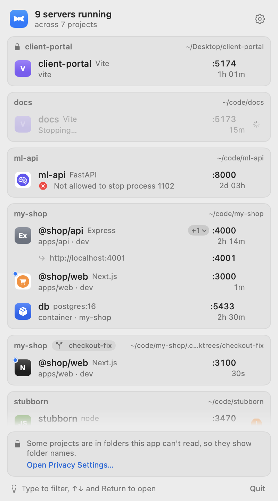

# Headwaiter

A macOS menu bar app that shows the dev servers running on your Mac, grouped by project, and lets you open, copy or stop each one. It reads processes directly (no port probing), so rows carry real project and package names. macOS 15 or later, Apple silicon and Intel.

<picture>
  <source media="(prefers-color-scheme: dark)" srcset="design/current/popover-list-dark.png">
  
</picture>

## What it detects

| Runtime | Recognized | Framework names and tiles |
| --- | --- | --- |
| **Node** (node, bun, deno) | Servers behind npm, pnpm, yarn, npx, bunx, tsx and nodemon are shown as one row. turbo, nx, concurrently and npm-run-all are treated as orchestrators, so each server under them gets its own row. | Next.js, Remix, React Router, Astro, Expo, Storybook, Nest, Vite, Express, Fastify, Hono, Koa |
| **Python** | `python`, `python -m …`, and runners (uv, poetry, pipenv, hatch, pdm, rye, pixi). Reloader parents are folded into the server. Jupyter kernels are hidden. | Django, FastAPI, Uvicorn, Flask, Jupyter |
| **Go** | `go run`, reloaders (air, gow, reflex, CompileDaemon), compiled binaries inside a `go.mod` project, Hugo | Gin, Echo, Fiber, Chi, Gorilla, Hugo |
| **Ruby** | `bundle exec`, Rails and Puma (including retitled workers). foreman, overmind and hivemind are treated as orchestrators. Spring and language servers are hidden. | Rails, Sinatra, Hanami, Jekyll, Puma, Rack |
| **Docker** | Containers with published ports, from Docker Desktop, OrbStack, Colima, Rancher Desktop or `DOCKER_HOST`. Compose containers join their project's card. | Image name (e.g. `postgres:16`) |

Projects are found from the nearest workspace root, git root or manifest (`package.json`, `deno.json`, `pyproject.toml`, `go.mod`, `Gemfile`). Git worktrees show as their own cards. Servers from other runtimes (Java, PHP, Rust, .NET…) aren't detected yet: see "Adding a runtime" below.

**Row icons:**
- A row shows the project's own favicon when it has one. The app looks first in the usual places (`app/icon.*`, `public/favicon.*`, `static/favicon.*` and others), then optionally asks the running server for `/favicon.ico`.
- Starter icons from framework templates are recognized and skipped. Those rows keep a letter tile in the framework's color.
- Both icon behaviors can be turned off in Settings.

## Features

- Live list, grouped into project cards, refreshed every 2 s while open and 5 s otherwise, and immediately when a server exits.
- Click to open, Option-click to copy the URL. Right-click to set a custom URL, or to hide a port or project.
- Right-click a server or project to reveal its folder in Finder or open it in your terminal. Choose which terminal in Settings.
- Keyboard: type to filter by name, project, framework or port. ↑↓ select, Return opens, ⌘C (or ⌥Return) copies the URL, ⌘R reveals the folder in Finder, ⌘T opens it in your terminal, ⌘⌫ stops, → and ← show and hide other ports, Esc backs out.
- A server listening on more than one port shows a **+N** chip. Click it to list the other ports under the row, each one clickable.
- Stop sends SIGTERM to the server's whole process tree, then offers Force Quit (SIGKILL) after 3 s. The force quit can be made automatic.
- Recently stopped list, a NEW dot on servers started since you last looked, and a menu bar dot when something changed.
- Optional notifications when a server starts, or stops without you stopping it. Restarts and short test runs stay quiet.
- Optional log: one line for each start and stop, with how long the server ran and whether Headwaiter stopped it. Filter it in its own window and clear it any time. It's a text file, `~/Library/Logs/Headwaiter/servers.log`.
- Settings: Open at Login, Appearance (System, Light, Dark), project icons, terminal, automatic force quit, updates, notifications, folder access, hidden items, log.
- Right-click the menu bar icon for Settings, updates, About, Capture Diagnostics and Quit.
- What Headwaiter sees stays on your Mac: no account, no analytics. It connects only to your own servers (redirects are never followed) and, for updates, to GitHub.
- Release builds update themselves with [Sparkle](https://sparkle-project.org). They ask before checking automatically and before installing anything. Builds from source never check.

## Install

[Download the latest release](https://github.com/individual11/headwaiter/releases/latest), open the DMG and drag Headwaiter to Applications. It's signed and notarized, and can update itself.

## Status

Beta, and in daily use by its author. Some stacks are only covered by hand-written tests so far, including Docker and Go. What's next is in the [roadmap](docs/ROADMAP.md).

## Build and run

```bash
scripts/make-dev-cert.sh          # optional, once: local signing cert so privacy grants survive rebuilds
scripts/build-app.sh debug        # → build/Headwaiter.app
open "build/Headwaiter.app"
scripts/install-app.sh            # release build into ~/Applications (never updates itself)
```

Needs Swift 6 (Xcode 16 or later). For signed, notarized builds see [RELEASING](docs/RELEASING.md).

macOS asks once for access to protected folders (Desktop, Documents, Downloads), where your projects live. The app doesn't touch them until you click Continue on the first-run card. If you deny access, servers there still appear under their folder names, marked with a lock.

**Debugging and design tools:**
- `HW_DEBUG=1 "build/Headwaiter.app/Contents/MacOS/Headwaiter"` logs every scan to stderr.
- `HW_SNAPSHOT=<dir> .build/debug/Headwaiter` renders every UI state to PNGs (light and dark), then exits. Current renders are in `design/current`, the explored directions in `design/explorations`, and the logo work in `design/logo`.

## Command-line scanner

```bash
swift run headwaiter-scan            # servers grouped by project
swift run headwaiter-scan --all      # plus skipped listeners and why
swift run headwaiter-scan --json
swift run -c release headwaiter-scan --bench 100
swift run headwaiter-scan --oracle   # check libproc against lsof
swift run headwaiter-scan --stop 3000 --force   # stop like the app: SIGTERM, wait 3 s, SIGKILL
swift run headwaiter-scan --capture "django runserver" Tests/HeadwaiterCoreTests/Fixtures/django.json
swift test
```

## Layout

- `Sources/HeadwaiterCore`: detection library, no dependencies.
  - `LiveProcessSource`: libproc and sysctl reader (sockets, argv, cwd, parents). Never shells out.
  - `RuntimeProfile`: the only place runtime knowledge lives: `NodeProfile` (node, bun, deno), `PythonProfile`, `GoProfile` and `RubyProfile`.
  - `Resolver`: groups shared sockets, collapses wrapper chains, resolves project and framework, picks the port and URL.
  - `Docker`: containers from the Docker Engine API over its Unix socket.
  - `Stopper`, `ExitWatcher`: subtree stop with PID-plus-start-time identity; kqueue exit events.
  - `ChangeTracker`: which starts and stops are worth a notification.
  - `ServerLog`: which starts and stops are logged, the line format and the log file.
  - `Favicon`, `FaviconFetcher`: where projects keep their icon, the starter-icon fingerprints, and the request to a running server.
  - `ListNavigation`: filtering and moving the selection.
  - `Fixture`: frozen machine state for tests, captured or hand-written.
- `Sources/headwaiter-scan`: CLI.
- `Sources/Headwaiter`: menu bar app.
  - `ServerStore`: polling, stop, history.
  - `FaviconStore`: project icons.
  - `Notifier`: start and stop notifications.
  - `LogStore`, `LogWindow`: the log and its window.
  - `TerminalApps`: which terminal folders open in.
  - `Updater`: Sparkle, the app's only dependency.
  - `PopoverKeyboard`: typing, selection and shortcuts in the list.
  - `PopoverView`, `SettingsView`, `MenuBarIcon`.
- `scripts/`: app bundling, dev signing, icon, release.
- `Tests/HeadwaiterCoreTests`: fixture-driven tests (Swift Testing). `Fixtures/` holds captures from real machines.

## Adding a runtime

Write a `RuntimeProfile`: executable matcher, wrapper roles, project markers, framework table. Add it to `Resolver.defaultProfiles`, then add fixtures. The resolver itself shouldn't need changes. Compiled runtimes, where the server is the project's own binary, override `runtimeName(of:context:)` to look at the executable's folder and parent process (see `GoProfile`). Docker containers come from `DockerSocketSource`, not process inspection.

## Contributing

See [CONTRIBUTING](CONTRIBUTING.md), and [SECURITY](SECURITY.md) for reporting vulnerabilities.

## License

[MIT](LICENSE)
